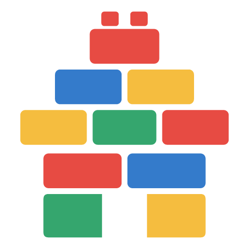

# 项目积木工坊 · Project Blocks 1.3.1



四色积木小屋标志已用于工具页、网页标签及 Codex 插件与 skill。可编辑矢量源文件与导出版本位于 `design/brick-house-logo/`。

基于 **galgame_script_editor 1.12 / GalFlow** 改造的本地项目工序可视化工具。保留原工具的无限画布、卡片拖动、端口连线、分组、便签、小地图、主题与撤销，增加项目工序和 Codex 文件协作。

## 启动

双击本目录下的 `启动.cmd`。脚本使用本机 Python 启动服务并打开浏览器：

<http://127.0.0.1:8765>

保持启动窗口运行，结束使用后在窗口按 Ctrl+C。需要 Python 3.10+；无需 pip、npm、API Key 或联网安装。启动脚本优先使用本机 Codex 已带的 Python，也支持系统 Python。

也可在本目录运行 `python server.py`（macOS / Linux 使用 `python3`）。首次运行会从随附模板创建 `data/project.json`；已有工程不会被替换。端口占用时运行 `python server.py --port 8766`。

直接打开 `app/index.html` 可以离线编辑和导出 JSON。与 Codex 同步工程文件需要通过本地服务打开。

## 使用流程

1. **搭积木**：点击左侧需求、模块、任务、资源、决策、验收按钮，或拖进画布。可从「从大纲生成」批量追加卡片，按缩进建立组成关系，或按行序建立前置依赖。
2. **接关系**：从右侧端口拖到目标卡片。双击卡片可编辑多条输出关系：前置依赖、组成模块、提供资源、验证结果、参考关联。拖动空白端口增加依赖，拖动已有关系端口更换目标。点击连线会弹出断开确认。
3. **写工序**：双击卡片填写负责人、优先级、关联文件、交付物、验收标准、执行说明与阻塞原因。支持待开始、进行中、受阻、待验收、已完成状态。未完成的前置依赖会显示提醒；在编辑器中无法将它的后续工序直接标为完成。
4. **发任务**：点击卡片选择；Shift 点击多选。点击「Codex 任务」生成选中卡片的任务说明；未选择时生成全工程任务。复制到相关项目的 Codex 聊天，或下载 Markdown。
5. **同步结果**：Ctrl+S 或「保存工程」把完整画布写到 `data/project.json`。让 Codex 修改该文件，页面每 3 秒检查更新；干净画布自动读取更新。有未保存修改时提示冲突，可下载备份、读取磁盘版本或保留当前画布。
6. **检查与验收**：「检查关系」报告循环依赖和缺少验收标准的工序。阶段结束后，根据实际验证结果更新卡片状态。

侧栏空间调整：拖动积木区和工程目录之间的横向分隔条，可调整上下显示区域；拖动侧栏右侧边缘，可调整整体宽度。区域缩小时可独立滚动，尺寸会在同一浏览器中保存。双击分隔条恢复默认大小；分隔条聚焦后也可使用对应方向键调整。主题与日夜模式同样会在刷新后保留。

从大纲生成示例：

```text
需求：做一个素材管理工具
  模块：素材导入
    任务：选择文件并读取元数据
    任务：实现列表预览
  模块：项目保存
    任务：实现 JSON 存取
  验收：完成一次导入、保存、重新打开
```

缩进表示组成关系；这与执行顺序不同。要表达先后顺序，请添加「前置依赖」，箭头从先做的卡片指向后做的卡片。

## 和 Codex 一起使用

可以把下面这段交给在该目录工作的 Codex：

> 请读取 `project-blocks/data/project.json`，按工序依赖理解项目。先检查对应的实际代码，再实施我选择的任务。完成后更新对应卡片的 `workflow.status`、关联文件和执行结果。保留其他卡片、ID、位置、分组及关系；不要把未验证的工作标记为已完成。

若 Codex 的工作目录就是本工具目录，文件路径是 `data/project.json`。也可以把工具复制到你正在开发的项目目录，再使用它。

通过文件、任务 Markdown 与执行进度命令协作。Codex 按 skill 在开始、切换和结束工序时上报进度；工具不读取聊天文本来猜测正在做什么，也不自行调用模型。

## 实时执行画布

Codex 上报当前工序后，对应卡片会出现从背面向四周扩散的暖黄色霓虹呼吸光、目录高亮和依赖连线流动；约 2.8 秒完成一次明暗呼吸，卡片本身不缩放。顶部显示工序名称与执行说明，点击「定位进行中」可跳到当前卡片。多个真实并行工序可同时高亮。支持经典、液体玻璃、P5R 的日夜主题与系统减少动态效果设置。

进度命令在实际项目根目录运行（卡片须已存在）：

```text
python project-blocks/progress.py --project-root . --node task_storage --status doing --message "正在实现保存接口"
python project-blocks/progress.py --project-root . --node task_storage --run python tests/test_storage.py
python project-blocks/progress.py --project-root . --node task_storage --status done --evidence "python tests/test_storage.py：通过"
```

`--run` 每 15 秒发送一次心跳，成功后进入待验收，失败后标记受阻。手动上报返回 `runId`，后续可用 `--run-id <返回值>` 续报；百分比只在实际可量化时使用 `--progress 0..100`。90 秒没有心跳或服务失联时停止运行动画，显示等待更新。切换工序、暂停或结束工作时应上报 `review`、`blocked` 或经验证的 `done`，避免留下过期的进行中状态。

心跳保存在忽略提交的 `data/activity.json`；状态和验收证据仍写回工程。页面每 2.5 秒读取心跳，进度字段单独合并，保留用户未保存的文字和布局；同一字段冲突仍需处理。完成状态需要证据且前置工序已完成。

旧项目升级：使用新版 skill helper 运行 `ensure --project-root "实际项目目录" --upgrade --start`。升级仅备份并替换工具运行文件，保留工程 JSON；旧文件在 `.upgrade-backups/`，使用返回的新 URL 重新打开右侧面板。未指定 `--upgrade` 时仍保留自定义运行文件。

## 数据格式

```json
{
  "title": "项目名称",
  "version": "1.0",
  "viewport": {"x": 40, "y": 80, "scale": 0.8},
  "nodes": [{
    "id": "task_example",
    "title": "实现项目保存",
    "routeType": "common",
    "color": "#73d2b3",
    "x": 100, "y": 100,
    "characters": "Codex",
    "location": "src/storage.js",
    "bgm": "可重新打开的工程文件",
    "summary": "保存卡片与关系",
    "script": "先阅读现有数据结构，再实现。",
    "choices": [],
    "workflow": {
      "status": "todo", "priority": "P1",
      "files": ["src/storage.js"],
      "acceptance": ["保存后重新打开内容一致"],
      "blockReason": ""
    }
  }],
  "groups": [], "stickyNotes": [], "customRoutes": []
}
```

兼容画布引擎的字段对应：`characters` 是负责人，`location` 是关联文件摘要，`bgm` 是交付物，`script` 是执行说明。工序类型：`prologue` 需求、`route` 模块、`common` 任务、`character` 资源、`branch` 决策、`ending` 验收。关系保存在源卡片 `choices` 中，包含唯一 `id`、显示名称 `text`、关系类型 `tag`、目标卡片 ID `target`。状态：`todo`、`doing`、`blocked`、`review`、`done`。

## 保存、备份与边界

- 当前工程：`data/project.json`，默认不提交到 Git；每次网页成功写入前，保存上一版为 `data/project.backup.json`。需要跟踪特定工程时，请自行调整忽略规则。
- 演示模板：`data/example.project.json`。初始卡片仅用于演示，状态不代表真实工程已经验收。
- 「导出 JSON」下载独立工程备份；打开菜单可导入 JSON。导入后需保存才会写到磁盘。
- 浏览器另有本地缓存，离线时可恢复同一浏览器的画布。连接服务时以磁盘工程为准；刷新或关闭前请保存，缓存不作为磁盘冲突恢复版本。
- 外部编辑器写入工程时，建议通过临时文件原子替换；写入有效 JSON 后画布才会读取。
- 支持每个工程最多 2000 张卡片，单次大纲生成最多 200 张；大图性能取决于浏览器。导入 GalFlow JSON 可以复用布局和关系，但原剧本字段会按项目字段显示。

## 开发与验证

`app/index.html` 是从指定 GalFlow 1.12 文件复制并适配的画布引擎。`app/blocks.js`、`app/blocks.css` 是项目积木功能层。`server.py` 只用 Python 标准库，在回环地址提供静态页面和 JSON 读写接口，保存时校验版本并原子替换文件。

Python 集成测试：`python tests/test_integration.py`。浏览器测试：安装 Node.js 后运行 `npm install`、`npx playwright install chromium`、`npm run test:browser`。测试使用独立临时工程，不修改当前画布。可用 `PYTHON` 环境变量指定 Python 可执行文件；使用系统 Edge 时设置 `BROWSER_CHANNEL=msedge`。测试脚本也可复用当前用户 Codex bundled runtime 的依赖，无需写死用户名或绝对路径。

## 开源许可

Project Blocks 采用 [MIT License](LICENSE)，版权所有 © 2026 Azhou / YZ2020CHINA。允许使用、修改、分发和商业使用；分发本软件或其主要部分时，须保留版权声明和 MIT 许可全文。软件按原样提供，不附带担保。

画布基础来自同一作者的 [GalFlow](https://github.com/YZ2020CHINA/GalFlow)。本仓库随附的画布代码与 Project Blocks 新增代码一并按 MIT 授权；这不更改 GalFlow 上游仓库自身的许可证。详见 [来源与授权说明](THIRD_PARTY_NOTICES.md)。

## Codex 插件与自动初始化

插件内置自动选择的 `project-blocks` skill。仓库自带本地市场 `.agents/plugins/marketplace.json`，可从仓库根目录运行：

```text
codex plugin marketplace add .
codex plugin add project-blocks@project-blocks-local
```

如果希望**后续所有本地新项目**默认建立画布，运行 `python integration/install.py`。此脚本会将插件复制到当前用户的 `~/.codex/plugins/project-blocks`，合并个人市场 `~/.agents/plugins/marketplace.json`，并备份、合并全局 `~/.codex/AGENTS.md` 中有标记的自动建图规则。它会输出个人市场的插件 selector；然后运行 `codex plugin add <输出的 selector>`。仅安装插件不自动更改全局规则。

以后在新聊天里实际开始创建本地软件项目时，Codex 会按全局规则使用 skill，在真实项目子目录中生成独立的 `project-blocks/` 文件夹，填充任务、模块与依赖，再启动本地服务并用 Codex 面板打开。已有工程复用且不覆盖卡片、坐标或自定义界面；各项目使用独立服务与数据。需要手动指定时输入 `$project-blocks 为当前项目建立并打开积木画布`。

该自动化在首次构建对话中运行，仅点击侧栏新建空项目不会启动。未使用生命周期 hooks、计划任务或常驻文件监控；权限仍受当前聊天约束。新安装的插件技能在新聊天/会话加载，插件列表未更新时重新打开 Codex 即可。

开发打包与验证：运行 `python integration/build_package.py`、`python tests/test_integration.py`。打包会更新仓库内的 skill 运行模板；完成后应重新安装插件，不要手动更改 Codex 缓存副本。`adapt.py` 仅供从原始 GalFlow HTML 重新生成画布时使用：`python adapt.py "原始 HTML 路径"`，会重建 `app/index.html`；日常运行无需该脚本。
